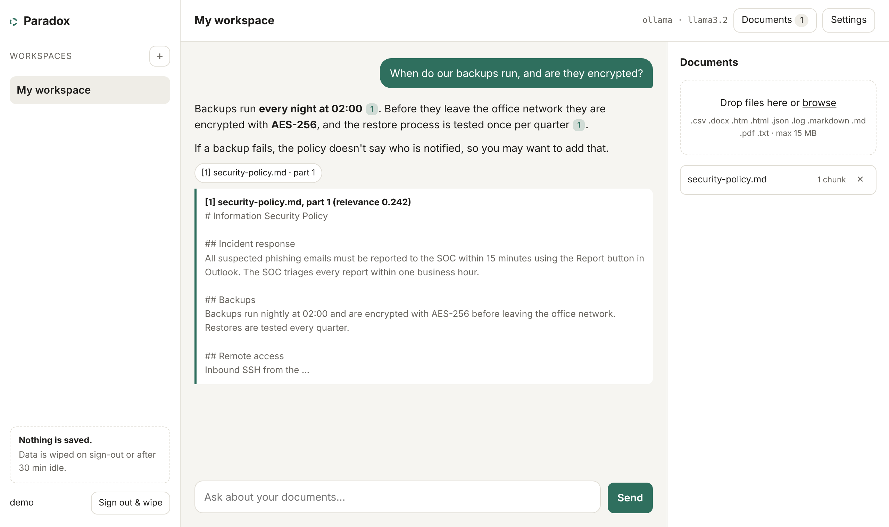
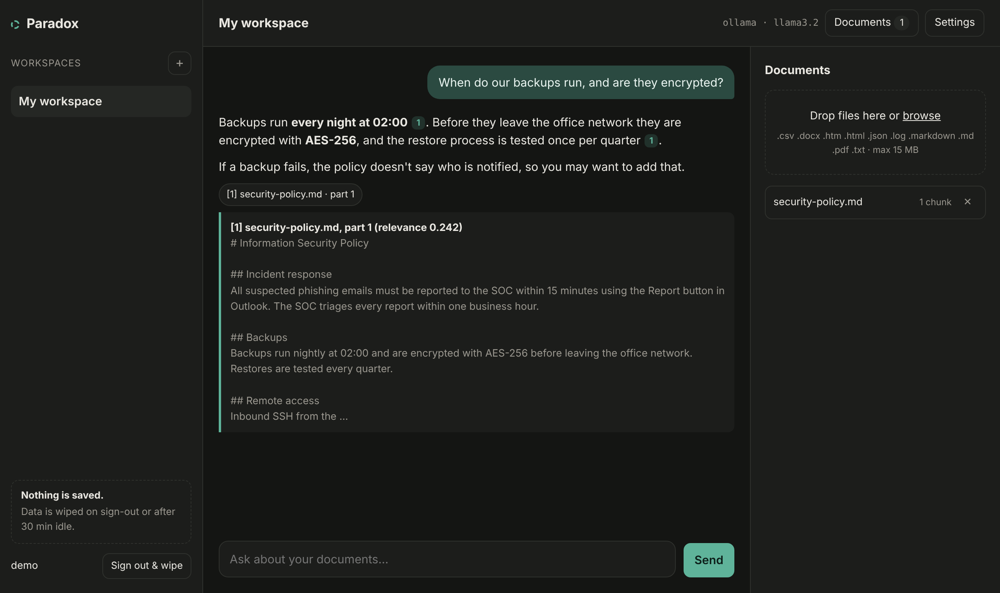
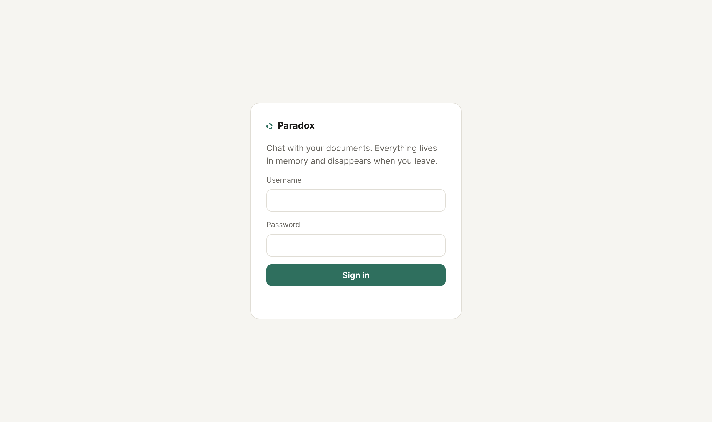

# Paradox

**Chat with your documents. Store nothing.**

[](https://github.com/najjar961/paradox/actions/workflows/tests.yml)


Paradox is a self-hosted, multi-user AI assistant for confidential documents and everyday work: contracts, reports, homework. Upload PDFs, Word files or notes, or just ask without a file. Ask questions, work through tasks, and get answers that cite the exact passage they came from. Documents, embeddings and chat history live only in server RAM for the length of a login session and are dropped on sign-out, after an idle timeout, at a maximum session age, or when the server stops. Run it with a local model through Ollama and your files never leave your own machine.



<details>
<summary>Dark mode and login</summary>




</details>

## Features

- Multi-user login (accounts from a read-only `users.yaml` of bcrypt hashes)
- Several workspaces per user, each with its own documents, chat and custom instructions
- Upload PDF, Word, Excel, PowerPoint, scans and photos, TXT, Markdown, CSV, JSON, HTML and log files
- **Work on tasks, not just documents:** upload homework or an assignment and use the task buttons above the box: *Explain step by step*, *Check my solution*, *Give me a hint*, *Summarise*, *Write a draft*, *Translate*. By default Paradox tutors (explains the method, checks your work, gives hints) and gives the full solution when you ask for it
- **Learn mode (Paradox Lite):** click *Quiz me* and your notes or lecture script become practice questions; uncover each answer, mark what you knew, then get new questions or practise the ones you missed. Type a topic in the box to quiz on just that, or on any topic without notes
- **Maths:** formulas in answers are rendered properly (KaTeX, as MathML, so the strict content security policy stays)
- Ask anything about a document, or ask Paradox to edit it ("rewrite this more formally", "fix the typos") and copy or download the result
- **Fill in PDF forms:** Paradox lists a form's fields with their visible labels; the AI fills them from what you tell it and your other uploaded documents (only listed options and real fields are accepted), you check every value, preview and download. Fields stay editable
- **Scans and photos:** scanned PDFs and photos (PNG, JPG, TIFF, WebP) are read with OCR in English, German, French and Arabic (Arabic in the correct reading order) and turned into searchable PDFs, so you can ask about them and redact them (the scanned pixels under a redaction are blanked)
- **Excel and PowerPoint:** ask about spreadsheets and slides, edit cell text, numbers and slide text in place (formatting, formulas, charts and images untouched; formulas recalculate when opened), and redact them
- **Remove personal data:** finds names, addresses, emails, phone numbers (including Lebanese ones), IBANs, card numbers, dates of birth and ID numbers, Arabic names after labels such as الاسم or السيد, lets you tick what goes, then truly redacts it (the text is removed from the file, not covered) and wipes the author and other hidden properties
- **Preview before download:** every edit or redaction opens a Before/After preview of the real pages with the changes highlighted
- **Keep original layout:** for PDF and Word files, Paradox proposes precise changes, you tick the ones you want, and it applies them to your original file. Logos, tables, fonts, colours and page layout stay as they were
- **Meaning-based search:** short documents are read in full; long ones are searched by meaning and by keywords at the same time, so "How long can I cancel?" finds "Die Kündigungsfrist beträgt drei Monate". Every citation says whether it was found by meaning, by keywords or both. Answers stream live with clickable `[1]` citations
- **Compare two documents:** drop in two versions and ask "what changed?", or click **Compare**. Paradox computes every difference exactly, word by word, shows them in place (removed struck through, added highlighted), and the AI explains what the changes mean. It only explains differences that are really there
- Model choice: **Ollama** (fully local), **OpenAI** or any OpenAI-compatible server, or **Anthropic**
- **English, German, French and Arabic interface:** follows the browser language, with a language picker that keeps everything on screen. Arabic is laid out right to left. Answers follow the language of your question
- **Installable and offline (Paradox Lite):** install it like an app; after the first use it opens and works with no internet at all
- **[Security page](https://najjar961.github.io/paradox/security.html):** what Paradox promises, and step-by-step checks anyone can do in a few minutes to verify it
- Light and dark mode, works on mobile

## How search and comparing work

**Search.** Each long document is split into passages. Paradox ranks them twice: by keywords (BM25, good for names, numbers and exact terms) and by meaning (embedding vectors, good for questions phrased differently from the text, or in another language). The two rankings are merged with reciprocal rank fusion, so a passage both methods agree on comes first. The self-hosted app uses your embedding model (`EMBED_MODEL`; for German documents `bge-m3` works much better than the English-focused `nomic-embed-text`). Vectors live in session memory like everything else.

**Comparing.** The comparison is done by code, not by the AI: paragraphs are aligned first, then the words inside changed paragraphs (`app/compare.py`, `docs/app/compare.js`). The AI gets only the numbered list of real differences and is told to explain them, most important first (amounts, dates, deadlines, obligations), quoting old and new values. It never sees an invented change, and you can check every claim in the comparison view.

## Editing PDF and Word files without losing the layout

With **Keep original layout** switched on (it appears once a PDF or Word file is uploaded), the model does not rewrite the document. It answers with a list of changes:

```
FIND: Die Laufzeit beträgt 24 Monate.
REPLACE: Die Laufzeit beträgt 36 Monate.
```

Before you see them, Paradox **checks every change against your document**. If the model paraphrased the text it wants to replace, Paradox finds the closest real passage and asks the model once to correct the change; anything still not found is unticked and marked. You then untick anything you don't want, look at a Before/After preview of the real pages, and download the edited original.

- **PDF:** each change is located by its words (tolerant of punctuation, quotes, case, line-break hyphens and small wording differences). The affected lines are removed with a real redaction, so the old text is gone from the file, not hidden under a box. The new text is drawn in the same place, size and colour, justified, left, right or centred like the original. Paradox reuses the PDF's own embedded font when it contains every needed letter, otherwise a font with identical letter widths (Carlito for Calibri, Liberation for Arial and Times, DejaVu), otherwise a standard font scaled to the same width. If the new text is longer, it uses free space below or is set slightly smaller, and tells you so.
- **Word:** only the words that differ are replaced inside the existing runs, so bold, italics, colours, styles, tables, headers and footers are untouched.
- Limits: text in scanned documents can be redacted but not rewritten, and rotated pages and changes spanning two pages are not supported. A PDF can't reflow following paragraphs, so much longer text has to fit the existing space.

The self-hosted app does this with [PyMuPDF](https://github.com/pymupdf/PyMuPDF) and python-docx (`app/layout_edit.py`); Paradox Lite does the same in the browser with [MuPDF.js](https://github.com/ArtifexSoftware/mupdf.js) and JSZip (`docs/app/layout.js`).

## Paradox Lite: no install, runs in your browser

**[Try it: najjar961.github.io/paradox/app](https://najjar961.github.io/paradox/app/)**

Paradox Lite is a static page in [`docs/app/`](docs/app/) that does everything on the visitor's own device:

- Files are read in the page with pdf.js and mammoth. They exist only in JavaScript memory, never in browser storage.
- The AI model runs on the visitor's graphics card through [WebLLM](https://github.com/mlc-ai/web-llm) and WebGPU. Users pick Qwen3 1.7B (the default, about 1 GB, so the first start is quick), Qwen3 4B or Qwen3 8B, with Qwen3's long "thinking" switched off for speed. Returning visitors get the model they already downloaded, and the download shows the time left; the public weights download once from Hugging Face and are cached by the browser.
- Short documents are read whole; long ones are searched by meaning and keywords. Meaning search uses [multilingual-e5-small](https://huggingface.co/Xenova/multilingual-e5-small) (about 120 MB, 100 languages) through [Transformers.js](https://github.com/huggingface/transformers.js) in a background thread on the visitor's device; it can be switched off, and keyword search (BM25) is used until it's ready. Answers stream with a Stop button, and can be downloaded as PDF, Word or text, built in the browser.
- A Content-Security-Policy in the page only allows requests to this site and the model hosts, so documents cannot be sent anywhere else.
- All libraries are served from this repository ([`docs/app/vendor`](docs/app/vendor/LICENSES.md)), so visitors' browsers never contact a third-party CDN.

- Installable as an app (web app manifest). A service worker (`docs/app/sw.js`) keeps a copy of the app's own files so it works offline; once a model is loaded, every feature does. It only ever caches this site's program files, never documents, and ignores requests to other sites.

It needs a recent Chrome or Edge with WebGPU and a few GB of free graphics memory. To test the interface without a GPU, open `app/#selftest`, which uses a stand-in model.

## How "no data storing" is enforced

| Layer | What happens |
|---|---|
| Storage | No database. Everything lives in Python objects tied to a session token. |
| Uploads | Files are sent as a raw request body and parsed from memory (`BytesIO`). The multipart parser is not used, because it spools large files to temp files on disk. |
| Session end | Sign-out, `SESSION_IDLE_MINUTES` idle, `SESSION_MAX_HOURS` age, or shutdown destroys the session and empties its workspaces. A background reaper runs every minute. |
| Logs | Uvicorn access log is off. The app never logs document or chat content. |
| Browser | `Cache-Control: no-store` on every response; nothing is put in `localStorage`. |
| Container | `read_only: true` root filesystem; the only writable path is a RAM-backed `tmpfs`. |
| Tests | `test_nothing_written_to_disk` spies on `open()` during upload and chat and fails if anything is written. |

**Honest limits:** Python cannot securely zero freed memory, so wiped data stays in RAM until it is overwritten; if the host swaps, RAM can reach disk (disable swap or use encrypted swap). If you choose OpenAI or Anthropic, your document chunks and questions are sent to that provider and are subject to their retention policy. Use Ollama for a fully local setup.

## Security measures

- bcrypt password hashes; constant-time check for unknown usernames
- Login rate limit per client and username (`LOGIN_MAX_ATTEMPTS` per `LOGIN_WINDOW_SECONDS`)
- Session cookie is `HttpOnly`, `Secure`, `SameSite=Strict`; random 256-bit tokens; new token on every login
- CSRF token required in the `X-CSRF-Token` header on all state-changing requests
- Strict Content Security Policy (no inline scripts), `X-Frame-Options: DENY`, HSTS, `nosniff`, no referrer
- Per-session isolation: every workspace lookup is scoped to the caller's session
- Upload size cap, file type allow-list, chunk and workspace quotas per session
- Prompt-injection hardening: document text is wrapped in `<source>` tags, any attempt inside a document to close or forge those tags is neutralised, and the model is told to treat sources as data
- Model output is HTML-escaped before the minimal Markdown rendering, so documents cannot inject script into the page
- API docs (`/docs`, `/openapi.json`) are disabled

## Quick start (Docker, local models)

```bash
cp .env.example .env
cp users.example.yaml users.yaml
python scripts/hash_password.py alice     # paste the printed line into users.yaml
docker compose up -d --build
docker compose exec ollama ollama pull qwen3:8b
docker compose exec ollama ollama pull bge-m3
```

Open http://localhost:8000. For plain-http local testing set `COOKIE_SECURE=false` in `.env`, otherwise the browser will not keep the session cookie. For anything beyond localhost, put a TLS reverse proxy (Caddy, Traefik, nginx) in front and keep `COOKIE_SECURE=true`.

The Ollama service uses an NVIDIA graphics card if there is one (see `docker-compose.yml`; delete the `deploy:` block if you have none). `qwen3:8b` needs about 6 GB of graphics memory; on weaker machines use `qwen3:4b`, on 12 GB+ cards `gemma4:12b` is worth trying. Set the model in `.env` (`LLM_MODEL`).

The example users file contains a `demo` account with password `change-me-please`. Delete it before exposing the app.

## Run without Docker

```bash
pip install -r requirements.txt
cp users.example.yaml users.yaml
COOKIE_SECURE=false uvicorn --factory app.main:create_app --port 8000 --no-access-log
```

To try the UI with no model at all: `LLM_PROVIDER=echo EMBED_PROVIDER=hash`.

## Using hosted models

```env
LLM_PROVIDER=anthropic
LLM_MODEL=claude-sonnet-5-5
ANTHROPIC_API_KEY=...
EMBED_PROVIDER=openai          # Anthropic has no embeddings API; or keep ollama
EMBED_MODEL=text-embedding-3-small
OPENAI_API_KEY=...
```

## Tests

```bash
pip install pytest
python -m pytest -q
```

Browser tests drive both apps in a real Chromium with stand-in models (compare, export, stop, task buttons, German, French and Arabic interface, phone layouts in every language, offline mode, the self-hosted login and chat):

```bash
pip install playwright && python -m playwright install chromium
python -m pytest tests/browser -q
```

GitHub Actions runs the unit tests, the browser tests and a Docker build on every push.

They cover login and rate limiting, cookie flags, CSRF, the full upload/retrieve/chat flow, hybrid search, document comparison, DOCX and PDF parsing, upload limits, isolation between users, wipe on logout and idle expiry, the no-disk-writes check, prompt delimiter forging, and chunking.

## Layout

```
app/
  main.py        routes, auth dependencies, security headers, streaming chat
  store.py       in-memory sessions, workspaces, vector search (numpy cosine)
  ingest.py      text extraction from bytes and chunking
  providers.py   Ollama / OpenAI / Anthropic chat and embeddings
  rag.py         prompt assembly and citations
  search.py      hybrid search (BM25 + embeddings, rank fusion)
  compare.py     exact paragraph and word comparison of two documents
  auth.py        users file and login rate limiter
  static/        single-page UI (vanilla JS, no build step)
scripts/hash_password.py
tests/test_app.py
```

## Scaling note

Sessions live in one process's memory, so run a single worker (the default). Several replicas would need sticky sessions at the load balancer. Vector search is brute-force numpy, which is fast up to tens of thousands of chunks per user; the per-session chunk quota keeps it in that range.

## Contributing

Issues and pull requests are welcome. Run `python -m pytest -q` before opening a PR; CI runs the same tests and a Docker build. For security problems, see [SECURITY.md](SECURITY.md) and report them privately.

## Licence

Paradox is licensed under the [GNU AGPL-3.0](LICENSE). You can use, modify and self-host it freely. If you offer a modified version to others over a network, you must make your source code available to those users under the same licence.

For a commercial licence without these terms, or a managed installation, get in touch.

## Website

The landing page is [`docs/index.html`](docs/index.html). To put it online for free, open the repository's **Settings → Pages**, choose **Deploy from a branch**, then branch `main` and folder `/docs`. It will be live at `https://najjar961.github.io/paradox/`.
